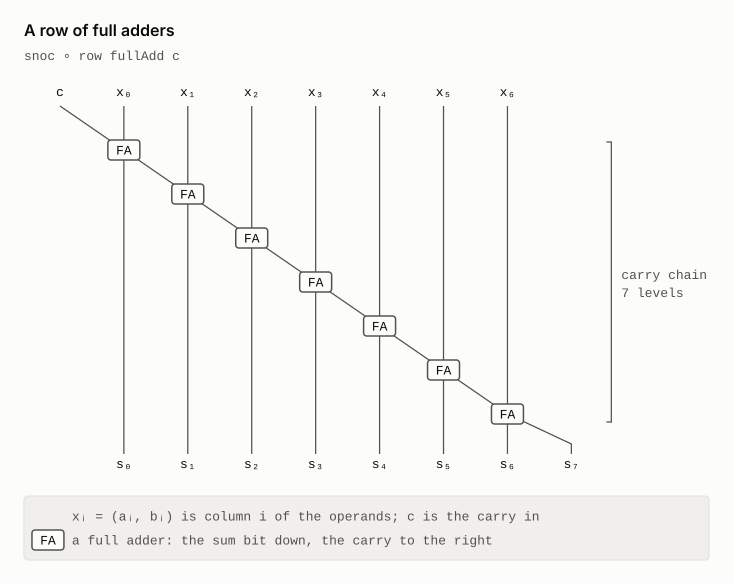
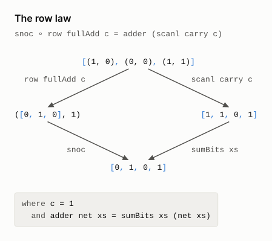
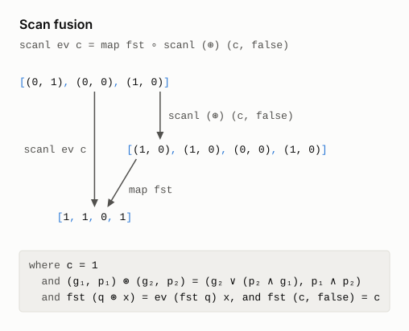
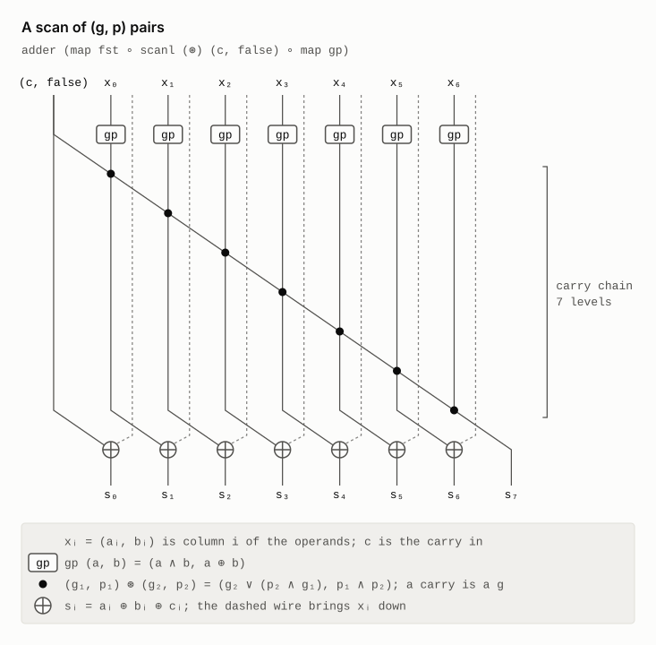
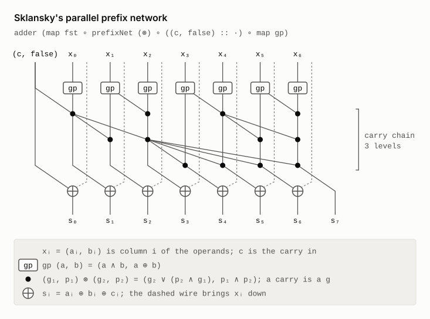

# A carry-lookahead adder

The carry into column `i` of a binary addition is set when the low `i` columns,
plus the carry in, overflow `i` bits. That is the whole specification. A
ripple-carry adder computes the carries one column at a time. A carry-lookahead
adder computes them with a parallel prefix network.

`carries_eq_prefixNet`, in [`Adder.lean`](Adder.lean), derives the second from
the first. Columns run least
significant first. The right column is the depth of the carry chain for `n`
columns.

```
  map (carryOut c) ∘ inits                                  the specification
= map (foldl carry c) ∘ inits                               full-adder law
= scanl carry c                                             scan lemma          n
= scanl ev c ∘ map gp                                       carry = g ∨ (p ∧ c)
= map fst ∘ scanl (⊛) (c, false) ∘ map gp                   scan fusion
= map fst ∘ scan1 (⊛) ∘ ((c, false) :: ·) ∘ map gp          definition of scan1
= map fst ∘ prefixNet (⊛) ∘ ((c, false) :: ·) ∘ map gp      parallel prefix     ⌈log₂ (n + 1)⌉
```

Here `gp (a, b) = (a ∧ b, a ⊕ b)` gives a column's generate and propagate bits.
The carry operator is `(g₁, p₁) ⊛ (g₂, p₂) = (g₂ ∨ (p₂ ∧ g₁), p₁ ∧ p₂)`. It is
associative, and that is all the last step needs. The carry in enters as an
extra column that generates `c`.

The scan lemma is the one from the [Kadane derivation](../kadane/README.md). Scan
fusion does the job that fold fusion does for the [CRC](../CRC/README.md).

`prefixNet` is Sklansky's network. It scans both halves at once. Then it
combines the left half's total into every result of the right half. It takes
its operator as an argument, so the same code has three readings.

| Run it on | It computes | Theorem |
|---|---|---|
| bits, with `⊛` | the carries | `cla_correct`: the output, read as a number, is the sum |
| arrival times, with `later t u = max t u + 1` | each output's depth | `prefixNet_depth`: at most `⌈log₂ n⌉` levels; `serial_depth`: the serial scan needs `n - 1` |
| symbolic gates | a netlist | `claNet_correct`: the netlist adds |

`lake exe adder_netlist` prints the netlist as Verilog. Each distinct gate
becomes one wire. The 32-bit adder is
[`netlist/sklansky_adder_32.v`](netlist/sklansky_adder_32.v).

| Width | Ripple gates | Ripple depth | Sklansky gates | Sklansky depth |
|---|---|---|---|---|
| 8 | 48 | 17 | 55 | 9 |
| 16 | 96 | 33 | 131 | 11 |
| 32 | 192 | 65 | 307 | 13 |
| 64 | 384 | 129 | 707 | 15 |

Depth counts two-input gates on the longest path. Sklansky buys logarithmic
depth with more gates: 1.6 times as many at 32 bits, 1.8 at 64. Both netlists come from lines of the
derivation: `rippleNet` from the third, `claNet` from the last.

Only the Verilog printer is unverified. Two outside tools check what it prints.

```bash
make -C Adder/netlist lint     # Verilator with every warning on: clean
make -C Adder/netlist equiv    # Yosys SAT: the adder equals + for every input
```

The SAT proof passes at widths 8, 32 and 64. A netlist with one gate flipped
fails it.

## From ripple-carry to carry-lookahead, directly

`refine_cla_from_ripple_carry` relates the two adders themselves. It starts
from the ripple-carry adder as Lava builds it: `row fullAdd`, a chain of full
adders. It ends at `cla`. Neither end mentions the specification.

```
  snoc ∘ row fullAdd c                                             a row of full adders   n
= adder (scanl carry c)                                            row law
= adder (scanl ev c ∘ map gp)                                      carry = g ∨ (p ∧ c)
= adder (map fst ∘ scanl (⊛) (c, false) ∘ map gp)                  scan fusion
= adder (map fst ∘ scan1 (⊛) ∘ ((c, false) :: ·) ∘ map gp)         definition of scan1
= adder (map fst ∘ prefixNet (⊛) ∘ ((c, false) :: ·) ∘ map gp)     parallel prefix        ⌈log₂ (n + 1)⌉
= cla c                                                            definition of cla
```

`adder net xs = sumBits xs (net xs)` wraps a carry network `net`. It adds one
XOR per column, then the carry out. `snoc` puts the row's last carry on top of
its sum bits.

The row law is the one new step. A row's carries are a scan, and each output
reads its column and the carry into it. After it come the steps above, under
`adder`. The netlist section's `rippleNet` is the second line, `adder (scanl
carry c)`, built from gates.

## Each step of the refinement, as a law and a circuit

The diagrams below follow `refine_cla_from_ripple_carry` one step at a time.
Each step has a law diagram, which applies its law to an example, and a
schematic of the circuit after the step. A law diagram's left path is the line
before the step, and its right path is the line after it. Both end at the same
value.

- **Law diagrams.** They add `5 + 4` with a carry in of 1, in three columns.
  Bits are written 1 and 0, least significant first. The first column
  propagates the carry in, the second kills it, and the third generates the
  carry out.
- **Schematics.** They show seven columns, with column 0, on the left,
  carrying the carry in. Time runs down the page: each cell sits one level
  below the latest of its inputs, so a schematic's height is its depth. The
  bracket on the right spans the carry chain.

[`diagrams/AdderDiagrams.lean`](diagrams/AdderDiagrams.lean) draws them. Each
schematic comes from running its line's own `row`, `scanl`, `scan1` or
`prefixNet` on symbolic wires. Before it is drawn, it is evaluated cell by
cell with the functions in `Adder.lean`, and it must add correctly on all 2¹⁵
inputs. CI redraws the diagrams and checks that they match the committed
files.

```bash
lake exe adder_diagrams      # redraws the adder SVGs in Adder/diagrams
```

### The ripple-carry adder

The derivation starts from Lava's ripple-carry adder: a row of full adders,
each passing its carry to the right. The carry chain is as long as the adder.

<picture>
  <source media="(prefers-color-scheme: dark)" srcset="diagrams/adder_circuit_ripple_dark.svg">
  
</picture>

### 1. The row law

A row's carries are a scan, and each output reads its column and the carry
into it. So the row splits into a chain of `carry` cells and a row of sum
cells. The chain is as deep as before.

<picture>
  <source media="(prefers-color-scheme: dark)" srcset="diagrams/adder_row_law_dark.svg">
  
</picture>

<picture>
  <source media="(prefers-color-scheme: dark)" srcset="diagrams/adder_circuit_carry_chain_dark.svg">
  
</picture>

### 2. carry = g ∨ (p ∧ c)

Each `carry` cell splits into a `gp` cell, which reads only its own column,
and an `ev` cell on the chain. Scan–map fusion moves the `gp` cells out of the
scan, so they all work at once, on the first level.

<picture>
  <source media="(prefers-color-scheme: dark)" srcset="diagrams/adder_carry_ev_dark.svg">
  
</picture>

<picture>
  <source media="(prefers-color-scheme: dark)" srcset="diagrams/adder_circuit_gp_dark.svg">
  
</picture>

### 3. Scan fusion

The chain now carries `(g, p)` pairs, combined by `⊛`, and each carry is the
`g` of a pair. This works because `fst` takes each `⊛` step to an `ev` step.
A pair costs more than a bit, but `⊛`, unlike `ev`, is associative.

<picture>
  <source media="(prefers-color-scheme: dark)" srcset="diagrams/adder_scan_fusion_dark.svg">
  
</picture>

<picture>
  <source media="(prefers-color-scheme: dark)" srcset="diagrams/adder_circuit_scan_dark.svg">
  
</picture>

### 4. Definition of `scan1`

The carry in was the scan's seed. Now it is the first element of the list the
scan runs over, as the pair `(c, false)`: a column that generates `c` and
propagates nothing. No cell changes. A `#guard` checks that lines 4 and 5
build the same circuit, so the schematic above is the circuit of both.

<picture>
  <source media="(prefers-color-scheme: dark)" srcset="diagrams/adder_scan1_dark.svg">
  
</picture>

### 5. Parallel prefix

`⊛` is associative, so the scan's terms can be bracketed in any way. `scan1`
brackets them to the left, one after another. Sklansky's `prefixNet` brackets
them as balanced trees, so the last result waits 2 levels on four inputs,
not 3. At seven columns, eight inputs with the carry in, the carry chain drops
from 7 levels to 3.

<picture>
  <source media="(prefers-color-scheme: dark)" srcset="diagrams/adder_parallel_prefix_dark.svg">
  
</picture>

<picture>
  <source media="(prefers-color-scheme: dark)" srcset="diagrams/adder_circuit_sklansky_dark.svg">
  
</picture>

### 6. Definition of `cla`

`cla c` is the name of the circuit above, so the last step changes nothing.

## Why the adder suits a talk

- The spec is the definition of a carry. It assumes nothing about circuits.
- The derivation reuses two laws from the other examples: the scan lemma and fusion.
- Associativity is the reason the adder can be parallel. The proof makes that visible.
- A second calculation turns the textbook row of full adders into Sklansky's adder.
- One Lean function yields a proof, a depth analysis and a netlist. That is Lava's idea, checked.

## Related work

The closest work is O'Donnell and Rünger's functional pearl. It too turns a
ripple-carry adder into a carry-lookahead adder by calculation, in Haskell, as
a semi-formal correctness proof, and it draws the circuit at its main stages.
It meets the same obstacle: the ripple adder's carry scan uses a function that
is not associative. It finds associativity another way. It partially evaluates
each column's carry function, composes those functions with `∘`, and then
represents them as the symbols `K`, `P` and `G`, for kill, propagate and
generate. A tree-shaped parallel scan finishes the job. The derivation here
introduces the `(g, p)` pairs directly, by scan fusion, and ends at Sklansky's
network. It also starts from Lava's row of full adders, and Lean checks every
step.

- J. T. O'Donnell and G. Rünger,
  [Functional pearl: Derivation of a logarithmic time carry lookahead addition circuit](https://doi.org/10.1017/S0956796804005180),
  Journal of Functional Programming 14(6), 2004. An earlier version is in the
  [2001 Haskell Workshop proceedings](https://www.haskell.org/haskell-symposium/2001/2001-62.pdf).

The step to a parallel prefix network has an algebra of its own:

- R. Hinze, [An algebra of scans](https://www.cs.ox.ac.uk/ralf.hinze/publications/MPC04.pdf),
  Mathematics of Program Construction 2004, LNCS 3125. Two building blocks and
  four combinators describe the standard prefix circuits. The algebra's laws
  prove circuits correct and derive new ones, such as Brent–Kung and
  Ladner–Fischer.
- M. Sheeran,
  [Functional and dynamic programming in the design of parallel prefix networks](https://www.cambridge.org/core/journals/journal-of-functional-programming/article/functional-and-dynamic-programming-in-the-design-of-parallel-prefix-networks/BF6065585BE32438CDF081A44741A5B8),
  Journal of Functional Programming 21(1), 2011. Networks modelled in Haskell,
  with search, come out smaller than Ladner–Fischer's at the same depth.
- M. Sheeran,
  [Hardware design and functional programming: a perfect match](https://www.jucs.org/jucs_11_7/hardware_design_and_functional/jucs_11_7_1135_1158_sheeran.html),
  Journal of Universal Computer Science 11(7), 2005.
- C. Elliott,
  [Generic functional parallel algorithms: scan and FFT](https://doi.org/10.1145/3110251),
  ICFP 2017 ([free copy](https://conal.net/papers/generic-parallel-functional/generic-parallel-functional.pdf)).
  Scan algorithms follow from a few functor combinators, with no arrays and no
  indexing.

Circuits have been derived by refinement before, in Ruby, a relational language
for circuits, and described as functions in Lava:

- G. Jones and M. Sheeran,
  [Designing arithmetic circuits by refinement in Ruby](https://link.springer.com/chapter/10.1007/3-540-56625-2_15),
  Mathematics of Program Construction 1992, LNCS 669. A well-known arithmetic
  circuit follows from decisions made about the abstract algorithm, so it is
  correct by construction.
- G. Jones and M. Sheeran, Circuit design in Ruby, in J. Staunstrup (ed.),
  Formal Methods for VLSI Design, North-Holland, 1990.
- P. Bjesse, K. Claessen, M. Sheeran and S. Singh,
  [Lava: hardware design in Haskell](https://doi.org/10.1145/289423.289440),
  ICFP 1998. One circuit description, many interpretations: simulation,
  verification and netlists, as `prefixNet` has here.

The carry operator `⊛`, and carries as a scan:

- R. P. Brent and H. T. Kung,
  [A regular layout for parallel adders](https://doi.org/10.1109/TC.1982.1675982),
  IEEE Transactions on Computers C-31(3), 1982
  ([free copy](https://maths-people.anu.edu.au/~brent/pd/rpb060.pdf)). It
  defines the associative operator on `(g, p)` pairs.
- G. E. Blelloch, [Prefix sums and their applications](https://www.cs.cmu.edu/~scandal/papers/CMU-CS-90-190.html),
  CMU-CS-90-190, 1990. Adding numbers is one of its applications of scan.

Machine-checked proofs of prefix adders, which verify them rather than derive
them:

- F. Liu, Q. Tan and G. Chen,
  [Formal proof of prefix adders](https://www.sciencedirect.com/science/article/pii/S0895717710000609),
  Mathematical and Computer Modelling 52(1–2), 2010. Bit pairs with the carry
  operator form a monoid, and that proves the Kogge–Stone adder correct.
- Wang et al.,
  [Functional verification of high performance adders in Coq](https://doi.org/10.1155/2014/197252),
  Journal of Applied Mathematics, 2014. Carry-lookahead, Ling and parallel
  prefix adders, verified in Coq for every width.

Three informal explanations:

- Wikipedia's [Brent–Kung adder](https://en.wikipedia.org/wiki/Brent%E2%80%93Kung_adder)
  sketches the step from ripple carry to the operator on `(g, p)` pairs.
- A. Feldmann, [Carry lookahead adders](https://feldmann.nyc/blog/carry-lookahead-adder).
  The carries come from composing one-bit carry functions with a prefix
  network.
- K. Shirriff,
  [Reverse-engineering a carry-lookahead adder in the Pentium](https://www.righto.com/2025/01/pentium-carry-lookahead-reverse-engineered.html),
  2025. The carry merge is associative, so sub-ranges can be merged in any
  order.

## Trust

| Theorems | Axioms |
|---|---|
| `carries_eq_prefixNet`, `cla_correct`, `claNet_correct` | `propext`, `Classical.choice`, `Quot.sound` |
| `refine_cla_from_ripple_carry`, `rippleNet_correct`, `prefixNet_depth`, `serial_depth` | `propext`, `Quot.sound` |

The Verilog printer is unverified. Verilator and Yosys check its output.

## Building

The adder needs only core Lean. It shares the repository's one
[`lakefile.toml`](../lakefile.toml), which also requires Mathlib for the CRC.
Lake fetches Mathlib's source, but building the adder does not build Mathlib.
Run these from the root of the repository.

```bash
lake build Adder adder_diagrams adder_netlist   # checks the derivations
lake exe adder_diagrams           # the law diagrams and schematics of the refinement
lake exe adder_netlist            # the 32-bit adder as Verilog, and the gate counts
make -C Adder/netlist lint equiv  # Verilator and Yosys check the Verilog
```
