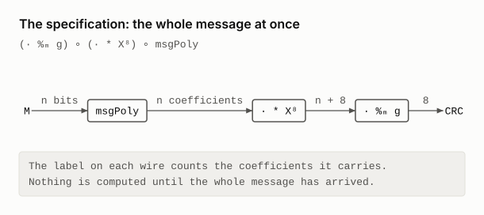
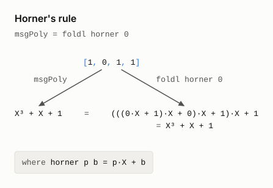
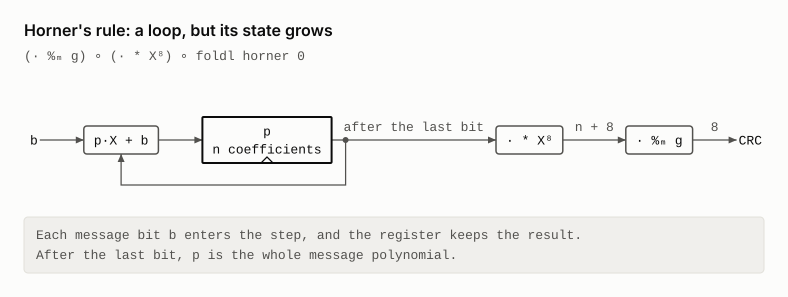
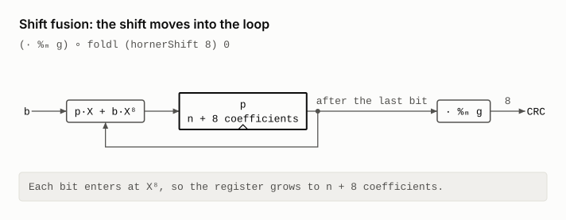
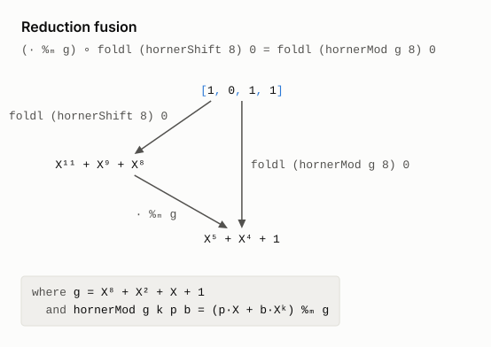
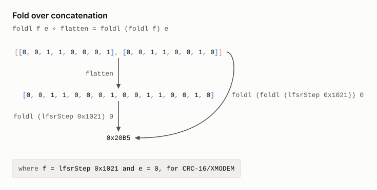
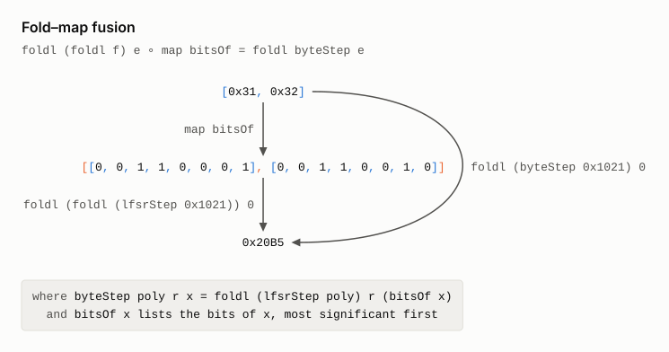
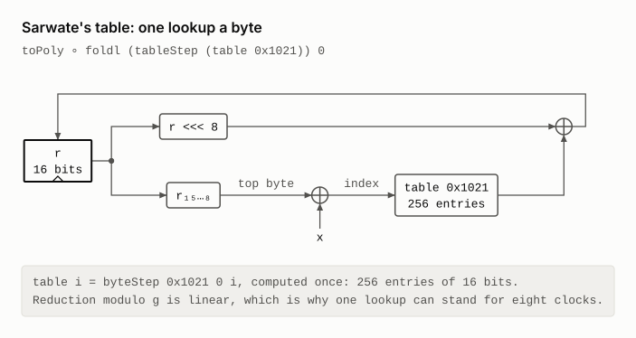

# A CRC

The textbook CRC is algebra. Read the message bits as a polynomial `M` over
GF(2). The CRC is the remainder of `M·Xᵏ` divided by a generator `g`.
Hardware never divides. It clocks bits through a `k`-bit shift register.

`crc_eq_lfsr`, in [`CRC.lean`](CRC.lean), derives that register, for every
generator. The right column is
the state each line keeps while it streams the message.

```
  (· %ₘ g) ∘ (· * Xᵏ) ∘ msgPoly                                    whole message
= (· %ₘ g) ∘ (· * Xᵏ) ∘ foldl horner 0   Horner's rule             n coefficients
= (· %ₘ g) ∘ foldl hornerShift 0         fold fusion: shift        n + k
= foldl hornerMod 0                      fold fusion: reduction    k
= toPoly ∘ foldl lfsrStep 0              fold fusion: refinement   k bits
```

`crcBytes_eq_table` goes on to Sarwate's table, one lookup per byte, for any
width `k ≥ 8`.

```
  crc ∘ flatten ∘ map bitsOf
= toPoly ∘ foldl lfsrStep 0 ∘ flatten ∘ map bitsOf    the derivation above
= toPoly ∘ foldl (foldl lfsrStep) 0 ∘ map bitsOf      fold over concatenation
= toPoly ∘ foldl byteStep 0                           fold–map fusion
= toPoly ∘ foldl tableStep 0                          Sarwate's table
```

The table step holds because reduction modulo `g` is linear. Its proof is a
short `calc` in `byteStep_eq_tableStep`.

The file also connects the derivation to this repo and to the CRC catalogue.

| Theorem | Says | Proved by |
|---|---|---|
| `crc8Next_eq_lfsrStep` | [`crc8.sv`](crc8.sv) is the derived LFSR | `bv_decide` |
| `crc8_rtl_correct` | after reset to `0xFF`, `crc8.sv` holds `(0xFF·Xⁿ + M·X⁸) mod (X⁸ + X² + X + 1)` | the laws |
| `xmodem_check` | the spec gives CRC-16/XMODEM's `0x31C3` on `"123456789"` | kernel `decide` |
| `smbus_check` | the spec gives CRC-8/SMBUS's `0xF4` | kernel `decide` |

The check values are theorems about the specification. No polynomial division
ever runs. The kernel runs the derived table loop instead.

## Each step, as a law and a circuit

The diagrams below follow both `calc` blocks one step at a time. Each step has
a law diagram, which applies its law to an example, and a schematic of the
program after it. A law diagram's left path is the line before the step, and
its right path is the line after it. Both end at the same value.

- **Bit by bit.** The steps of `crc_eq_lfsr` use CRC-8/SMBUS, whose generator
  `g = X⁸ + X² + X + 1` is the one in [`crc8.sv`](crc8.sv), on the message
  `1011`.
- **A byte at a time.** The steps of `crcBytes_eq_table` use CRC-16/XMODEM on
  the two bytes of `"12"`. At width 8 the shift in Sarwate's step is always
  zero, so width 16 shows the whole step.
- **Schematics.** The programs before the LFSR are loops over the message. Each
  is drawn as a machine: a step, a register that keeps its result, and the
  stages that read the register after the last bit. The register's label is
  the state the `calc` block's right-hand column counts.

[`diagrams/CrcDiagrams.lean`](diagrams/CrcDiagrams.lean) draws them. Mathlib's
polynomials over GF(2) do not compute, so it models them as bit masks. A
`#guard` checks the model against `lfsrStep` on every message of up to 8 bits.
Registers, bytes and the table come from `CRC.lean` itself. The LFSR is found
by running `lfsrStep` on each unit input: the step is linear, as a `#guard`
checks, so its taps are the bits each input flips. CI redraws the diagrams
and checks that they match the committed files.

```bash
lake exe crc_diagrams        # redraws the CRC SVGs in CRC/diagrams
```

### The specification

The CRC is defined on the whole message. Nothing can be computed until the last
bit has arrived.

<picture>
  <source media="(prefers-color-scheme: dark)" srcset="diagrams/crc_circuit_spec_dark.svg">
  
</picture>

### 1. Horner's rule

One multiply-add per bit builds the message polynomial, so the definition
becomes a loop. Its state is the whole polynomial so far, which grows with the
message.

<picture>
  <source media="(prefers-color-scheme: dark)" srcset="diagrams/crc_horner_dark.svg">
  
</picture>

<picture>
  <source media="(prefers-color-scheme: dark)" srcset="diagrams/crc_circuit_horner_dark.svg">
  
</picture>

### 2. Shift fusion

Multiplying by `X⁸` commutes with Horner's step, so it moves into the loop:
each bit now enters at `X⁸`. The state grows to `n + 8` coefficients.

<picture>
  <source media="(prefers-color-scheme: dark)" srcset="diagrams/crc_shift_fusion_dark.svg">
  
</picture>

<picture>
  <source media="(prefers-color-scheme: dark)" srcset="diagrams/crc_circuit_shift_dark.svg">
  
</picture>

### 3. Reduction fusion

Reducing modulo `g` commutes with the step too, so it also moves into the loop.
Now the state stays below degree 8, however long the message.

<picture>
  <source media="(prefers-color-scheme: dark)" srcset="diagrams/crc_mod_fusion_dark.svg">
  
</picture>

<picture>
  <source media="(prefers-color-scheme: dark)" srcset="diagrams/crc_circuit_mod_dark.svg">
  
</picture>

### 4. Data refinement

A register of 8 bits holds the 8 coefficients, and one clock of the LFSR is one
reduced Horner step. The LFSR is `crc8.sv`, gate for gate.

<picture>
  <source media="(prefers-color-scheme: dark)" srcset="diagrams/crc_refine_fusion_dark.svg">
  
</picture>

<picture>
  <source media="(prefers-color-scheme: dark)" srcset="diagrams/crc_circuit_lfsr_dark.svg">
  
</picture>

### A byte at a time

Software reads bytes. The bit-level derivation applies to a byte string once
`bitsOf` has turned each byte into eight bits, so the LFSR clocks eight times a
byte.

<picture>
  <source media="(prefers-color-scheme: dark)" srcset="diagrams/crc_circuit_serial_dark.svg">
  
</picture>

### 5. Fold over concatenation

Folding over the flattened bits is folding over each byte's bits in turn. No
gate changes: the schematic above is the circuit of this line too.

<picture>
  <source media="(prefers-color-scheme: dark)" srcset="diagrams/crc_fold_concat_dark.svg">
  
</picture>

### 6. Fold–map fusion

`bitsOf` joins the fold's step. Eight clocks become one `byteStep`, so the
register changes once a byte.

<picture>
  <source media="(prefers-color-scheme: dark)" srcset="diagrams/crc_fold_map_dark.svg">
  
</picture>

<picture>
  <source media="(prefers-color-scheme: dark)" srcset="diagrams/crc_circuit_bytestep_dark.svg">
  
</picture>

### 7. Sarwate's table

Reduction modulo `g` is linear, so eight clocks are one table lookup. The top
byte of the register meets the input byte, and the rest of the register shifts
up a byte.

<picture>
  <source media="(prefers-color-scheme: dark)" srcset="diagrams/crc_table_dark.svg">
  
</picture>

<picture>
  <source media="(prefers-color-scheme: dark)" srcset="diagrams/crc_circuit_table_dark.svg">
  
</picture>

## Related work on CRCs

- W. W. Peterson and D. T. Brown,
  [Cyclic codes for error detection](https://doi.org/10.1109/JRPROC.1961.287814),
  Proceedings of the IRE 49(1), 1961. It introduced the CRC, defined through
  polynomials, and the shift-register circuits that compute it.
- D. V. Sarwate,
  [Computation of cyclic redundancy checks via table look-up](https://doi.org/10.1145/63030.63037),
  Communications of the ACM 31(8), 1988. The table that `crcBytes_eq_table`
  ends at.
- T. V. Ramabadran and S. S. Gaitonde,
  [A tutorial on CRC computations](https://doi.org/10.1109/40.7773), IEEE Micro
  8(4), 1988 ([free copy](https://www.ee.bilkent.edu.tr/~ee538/crc.pdf)). The
  theory, then four software algorithms compared, among them table lookup.
- R. N. Williams,
  [A painless guide to CRC error detection algorithms](https://zlib.net/crc_v3.txt),
  1993. It goes from long division to table-driven code, and gives the
  parametrised model the catalogues use.
- G. Cook, [Catalogue of parametrised CRC algorithms](https://reveng.sourceforge.io/crc-catalogue/).
  The source of the check values in `xmodem_check` and `smbus_check`.
- G. Albertengo and R. Sisto,
  [Parallel CRC generation](https://doi.org/10.1109/40.60527), IEEE Micro
  10(5), 1990, and G. Campobello, G. Patanè and M. Russo,
  [Parallel CRC realization](https://doi.org/10.1109/TC.2003.1234528), IEEE
  Transactions on Computers 52(10), 2003. Both derive circuits that take
  several bits a clock from the serial LFSR, as `byteStep` takes eight.
- E. Kmett, [Parallel and incremental CRCs](https://www.schoolofhaskell.com/user/edwardk/parallel-crc),
  2013. In Haskell, the CRC as a fold, then as a monoid, so that it can be
  computed in parallel and updated after small edits.
- P. Koopman and T. Chakravarty,
  [Cyclic redundancy code (CRC) polynomial selection for embedded networks](https://doi.org/10.1109/DSN.2004.1311885),
  DSN 2004 ([free copy](https://users.ece.cmu.edu/~koopman/roses/dsn04/koopman04_crc_poly_embedded.pdf)).
  How to choose the generator `g`, which this derivation takes as given.
- The [hex-gf2](https://github.com/leanprover/hex-gf2) library implements
  polynomials over GF(2) in Lean, packed into machine words and without
  Mathlib, with proofs about division. It is the computable counterpart of the
  Mathlib polynomials used here.
- Wikipedia's [Computation of cyclic redundancy checks](https://en.wikipedia.org/wiki/Computation_of_cyclic_redundancy_checks)
  gives a series of equivalent algorithms, from code close to the mathematics
  to bytewise tables.

## Why the CRC suits a talk

- Every hardware engineer knows the spec. It fits on one line.
- One law, fold fusion, does three jobs: a shift, a reduction, a change of representation.
- Bits meet polynomials in one lemma, `toPoly_lfsrStep`. It covers one clock. Fusion does the induction.
- The derivation ends at RTL in this repo, and at published check values.
- It is small. `CRC.lean` is about 400 lines, with 38 theorems.

A possible running order for slides:

1. The spec: `(M·Xᵏ) mod g`.
2. Horner's rule. Now a loop, but its state grows with the message.
3. Two fusions. The state is now bounded by `k`, but still a polynomial.
4. Data refinement to a `k`-bit register. The one-clock lemma.
5. Bytes. Two list laws, then Sarwate's table from linearity.
6. The payoff. `crc8.sv` is that LFSR, and the check values are theorems.

## Trust

| Theorems | Axioms |
|---|---|
| the derivation and the check values | `propext`, `Quot.sound`, and `Classical.choice` from Mathlib |
| `crc8Next_eq_lfsrStep`, `crc8_rtl_correct` | the above, plus `CRC.crc8Next_eq_lfsrStep._native.bv_decide.ax_1_7`, the axiom with which `bv_decide` trusts its compiled check |

`crc8Next` is transcribed from [`crc8.sv`](crc8.sv) by hand. It is not
generated from the Verilog.

## Building

The CRC needs Mathlib, which the repository's one
[`lakefile.toml`](../lakefile.toml) requires. Fetch a prebuilt Mathlib first,
then run these from the root of the repository.

```bash
lake exe cache get           # a prebuilt Mathlib
lake build CRC crc_diagrams  # checks the derivations and the check values
lake exe crc_diagrams        # the law diagrams and schematics of the derivation
```
