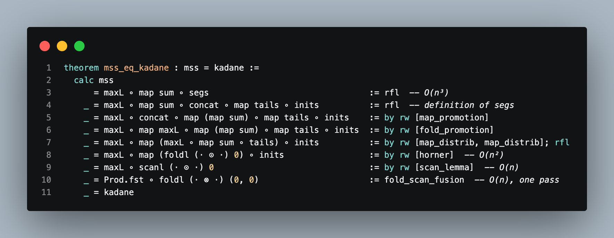
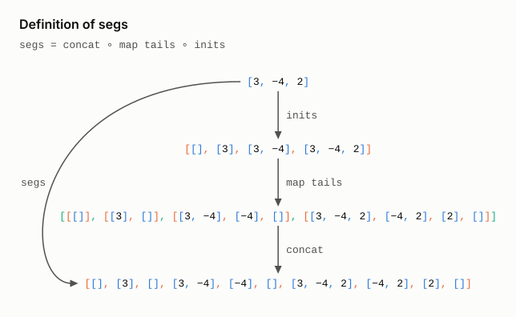
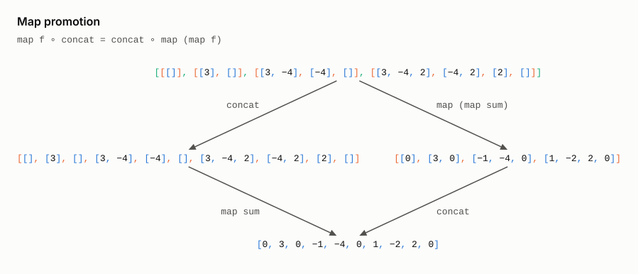
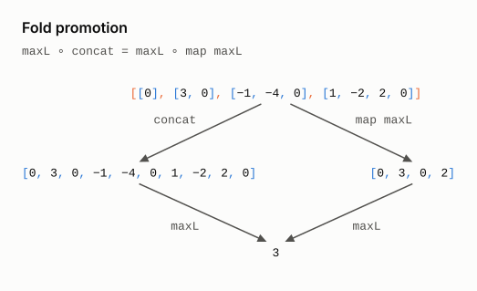
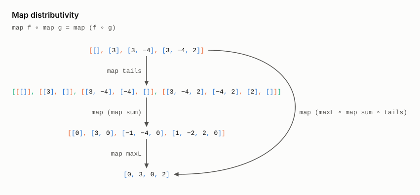
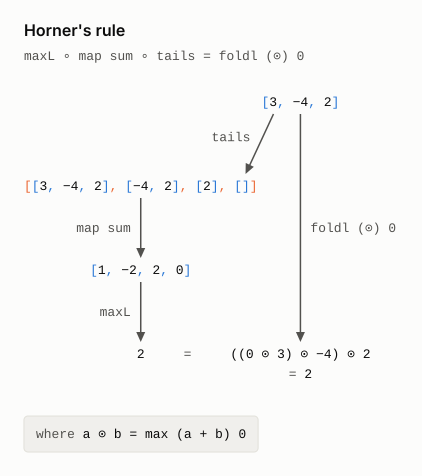
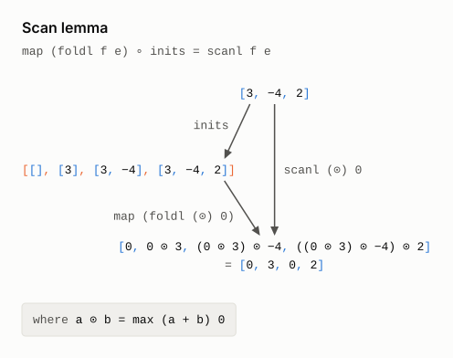
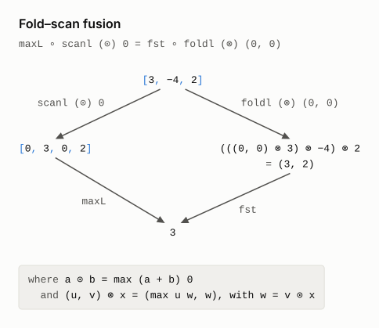

# Deriving Programs From Specifications in Lean 4 in the style of Bird-Meertens

This page describes the systematic derivation of an efficient algorithm from an obviously correct but inefficient specification using formally verified transformations, as illustrated in the code below (from [`Kadane.lean`](Kadane.lean)). With the recent advances in AI coding agents and the automation of proofs using AI theorem provers, this inspiring idea from the 1980s deserves another look.



The problem: give me a list of integers and ask for the contiguous segment with the largest
sum, and the obvious thing to do is to try every segment, add each one up, and
keep the biggest. For `[-2, 1, -3, 4, -1, 2, 1, -5, 4]` the winner is
`[4, -1, 2, 1]`, which sums to 6. This brute force approach is easy to believe
but it costs O(n³). Kadane's algorithm gets the same answer in a single O(n)
pass over the list, but it is not at all obvious why it works. Richard Bird
showed how to *calculate* Kadane's algorithm from the obvious specification,
one algebraic law at a time, in *Algebraic Identities for Program Calculation*
(The Computer Journal, 1989, §8). It is the poster child of the Bird–Meertens
formalism (affectionately known as Squiggol), and Wikipedia shows the same
derivation in its
[Bird–Meertens formalism](https://en.wikipedia.org/wiki/Bird%E2%80%93Meertens_formalism)
article.

Here I replay Bird's derivation in Lean 4. The specification is at
the top, Kadane's algorithm is at the bottom, and every step in between is a
law that Lean has checked (no hand waving, no "it is easy to see that"). The
bit I like best is that every line of the derivation is itself a runnable
program, so we can time each one and watch the complexity drop as the laws are
applied. Everything uses plain core Lean with no Mathlib.

## The Derivation

The whole derivation is one `calc` block, `mss_eq_kadane` in
[`Kadane.lean`](Kadane.lean). Each line is a program and each
step cites exactly one law, just like Bird's figure.

```
  maxL ∘ map sum ∘ segs                                 O(n³)
= maxL ∘ map sum ∘ concat ∘ map tails ∘ inits           definition of segs
= maxL ∘ concat ∘ map (map sum) ∘ map tails ∘ inits     map promotion
= maxL ∘ map maxL ∘ map (map sum) ∘ map tails ∘ inits   fold promotion
= maxL ∘ map (maxL ∘ map sum ∘ tails) ∘ inits           map distributivity
= maxL ∘ map (foldl (⊙) 0) ∘ inits                      Horner's rule     O(n²)
= maxL ∘ scanl (⊙) 0                                    scan lemma        O(n)
= fst ∘ foldl (⊗) (0, 0)                                fold–scan fusion  O(n)
```

The first line is the specification: take all the segments (every tail of
every prefix), sum each one, and take the maximum. The next four steps just
shuffle the plumbing around without changing the cost. Horner's rule is where
the magic happens: the best sum of a segment ending at some point can be
computed with a left fold of `a ⊙ b = max (a + b) 0`, which saves a factor of
`n`. The scan lemma notices that folding over every prefix is just a `scanl`,
which saves another factor of `n`. Finally, fold–scan fusion carries the
running maximum along with the fold, so we never build the intermediate list
at all. The pair operator is `(u, v) ⊗ x = (max u w, w)` where `w = v ⊙ x`,
and that last line is Kadane's algorithm.

A few details that matter in the Lean version:

- The lists hold `Int` values. The empty segment counts as a segment, so the
  answer is never negative (for `[-3, -1, -2]` the answer is 0).
- `maxL` folds `max` starting from `0`, which makes `0` its unit. This is what
  lets the empty segment and the laws play nicely together.
- The laws used in the middle of the pipeline carry a trailing `∘ g` so that
  `rw` can find them inside a longer composition.

## Each Step, on an Example

The [Wikipedia article](https://en.wikipedia.org/wiki/Bird%E2%80%93Meertens_formalism)
draws an example instance of each law. The diagrams below do the same for
every step of `mss_eq_kadane`, on the list `[3, −4, 2]`. Each applies its law
where the derivation applies it. The left path is the line before the step,
and the right path is the line after it. Both end at the same value. Steps are
numbered as in the table of running times, where step 1 is the specification.

Bracket colour shows depth. Blue brackets hold numbers, orange brackets hold
lists of numbers, and green brackets hold lists of those.

[`diagrams/KadaneDiagrams.lean`](diagrams/KadaneDiagrams.lean) draws them. It
computes every value with the definitions in `Kadane.lean`. It fails if the
two paths of a diagram end at different values, or if two pieces of text
overlap. CI redraws the diagrams and checks that they match the committed
files.

```bash
lake exe kadane_diagrams     # redraws the Kadane SVGs in kadane/diagrams
```

### 2. Definition of `segs`

A segment is a suffix of a prefix. The empty segment is a suffix of every
prefix, so it appears four times.

<picture>
  <source media="(prefers-color-scheme: dark)" srcset="diagrams/segs_dark.svg">
  
</picture>

### 3. Map promotion

`map sum` moves inside `concat`. Each prefix's suffixes are summed as a group.

<picture>
  <source media="(prefers-color-scheme: dark)" srcset="diagrams/map_promotion_dark.svg">
  
</picture>

### 4. Fold promotion

The largest of all the sums is the largest of each group's largest.

<picture>
  <source media="(prefers-color-scheme: dark)" srcset="diagrams/fold_promotion_dark.svg">
  
</picture>

### 5. Map distributivity

Three passes over the prefixes become one. `[0, 3, 0, 2]` holds the largest
suffix sum of each prefix. It comes back in steps 7 and 8.

<picture>
  <source media="(prefers-color-scheme: dark)" srcset="diagrams/map_distrib_dark.svg">
  
</picture>

### 6. Horner's rule

The largest suffix sum is a fold from the left. `⊙` drops `3 + −4` to `0`,
and the suffix starts again. The rule takes its name from polynomials: `+`
distributes over `max` as `·` distributes over `+`. The diagram shows the last
prefix. The derivation applies the rule to every prefix, under `map`. The cost
drops from O(n³) to O(n²).

<picture>
  <source media="(prefers-color-scheme: dark)" srcset="diagrams/horner_dark.svg">
  
</picture>

### 7. Scan lemma

The left path folds each prefix from scratch. The right path shares the work:
each element is one `⊙` on from the one before. Both paths write out the same
terms, so the lemma holds for any operator. The cost drops from O(n²) to O(n).

<picture>
  <source media="(prefers-color-scheme: dark)" srcset="diagrams/scan_lemma_dark.svg">
  
</picture>

### 8. Fold–scan fusion

The fold carries a pair. Its second component follows the scan, and its first
keeps the largest so far: `(0, 0)`, `(3, 3)`, `(3, 0)`, `(3, 2)`. So `fst`
gives what `maxL` gives, and no list is built.

<picture>
  <source media="(prefers-color-scheme: dark)" srcset="diagrams/fold_scan_fusion_dark.svg">
  
</picture>

## Running Times

The benchmark in [`bench/KadaneBench.lean`](bench/KadaneBench.lean) runs every
line of the `calc` block on random lists of growing length and times each one.

<picture>
  <source media="(prefers-color-scheme: dark)" srcset="bench/kadane_timings_dark.svg">
  
</picture>

Both axes are logarithmic, so a program that costs `c·nᵏ` shows up as a
straight line with slope `k`. The three complexity classes in Bird's
derivation turn up as three slopes, which I find very satisfying to see.

- Steps 1 to 5 sit right on top of each other. Their four laws move things
  around but leave the cost unchanged.
- Horner's rule knocks off a factor of `n`, and the scan lemma knocks off
  another.
- Fold–scan fusion is still O(n) but it runs about 7 times faster than the
  scan, because it never builds the intermediate list.
- At n = 512 the specification takes 271 ms, while the last line takes
  2.4 µs. That is about 110,000 times faster for the same answer.

| Step | Law | Bird's cost | Measured slope | n = 512 | Largest n | Time there |
|---|---|---|---|---|---|---|
| 1 | specification | O(n³) | 3.10 | 271 ms | 724 | 807 ms |
| 2 | definition of segs | O(n³) | 3.10 | 270 ms | 724 | 807 ms |
| 3 | map promotion | O(n³) | 3.09 | 268 ms | 724 | 803 ms |
| 4 | fold promotion | O(n³) | 3.12 | 266 ms | 724 | 799 ms |
| 5 | map distributivity | O(n³) | 3.13 | 265 ms | 724 | 796 ms |
| 6 | Horner's rule | O(n²) | 2.10 | 3.39 ms | 5,793 | 611 ms |
| 7 | scan lemma | O(n) | 0.99 | 16.5 µs | 131,072 | 4.39 ms |
| 8 | fold–scan fusion | O(n) | 1.02 | 2.42 µs | 131,072 | 661 µs |

The slopes of the first six lines come out a little above 3 and 2. My guess
is that `inits` keeps all `n²/2` prefix cells alive, so the memory traffic
grows a bit faster than the operation count.

You might worry that the benchmark is timing a slightly mistyped copy of a
line rather than the real thing. It is not: `lines_eq_mss` proves that every
timed program equals `mss`, and its proof replays the same laws. Each run also
checks that all eight lines agree on every input, just to be sure.

Each point is the fastest of three batches, where a batch repeats the call
until it lasts at least 20 ms. A line is dropped after its first call that
takes over 500 ms (which is why the cubic lines give up early). A slope is a
least-squares fit of `log t` against `log n`, using only calls of 100 µs or
more.

These numbers come from a single run on a 2.60 GHz Intel Xeon (a GCP VM) with
Lean 4.28.0, before the move to Lean 4.34.1. Your absolute times will be
different on another machine, but the slopes should hardly change. To run it
yourself, from the root of the repository:

```bash
lake exe kadane_bench        # takes about 40 seconds
lake exe kadane_bench 50     # stop each line at 50 ms instead of 500 ms
```

This writes every measurement to
[`bench/kadane_timings.csv`](bench/kadane_timings.csv) and redraws both SVG
plots (a light one and a dark one, picked to match your GitHub theme).

## AI Coding and AI Proofs

This approach of deriving programs from specifications was a great idea from the 1980s which was perhaps ahead of its time but I think has now found relevance in the age of AI coding. Specifically, AI coding agents and AI theorem provers can now work to synthesize and optimize code from specifications or draft implementations into efficient and correct by construction code (the guarantee comes from the checked proofs, not from the agent).

Previously the level of skill required and the laborious details needed to perform the proofs for practical programs made this approach difficult to apply. Now AI coding and automatic AI theorem proving advances mean we should look again at this approach for synthesizing code in a manner that still retains some form of comprehension for humans, given by the stepwise refinement steps which act as a kind of explanation of how code has been transformed and synthesized.

## Finding out more and some other related work

The GitHub repo [Algebra of Programming in Agda: Dependent Types for Relational Program Derivation](https://github.com/scmu/aopa) contains an Agda implementation of a library inspired by the [Algebra of Programming](https://www.amazon.com/Algebra-Programming-Prentice-Hall-International-Computer/dp/013507245X) as described in a book by Richard Bird and Oege de Moor (Oege is now famous for GitHub Copilot and XBOW).

[Jeremy Gibbons](https://www.cs.ox.ac.uk/people/jeremy.gibbons/) has written an article about [The School of Squiggol: A History of the Bird−Meertens Formalism](https://www.cs.ox.ac.uk/publications/publication13852-abstract.html).

## Building

The toolchain is pinned in [`lean-toolchain`](../lean-toolchain) (Lean
v4.34.1) and nothing outside core Lean is needed. Run these from the root of
the repository.

```bash
lake build Kadane            # checks the derivation
lake exe kadane_bench        # the timings and plots
lake exe kadane_diagrams     # the diagram of each step
```
